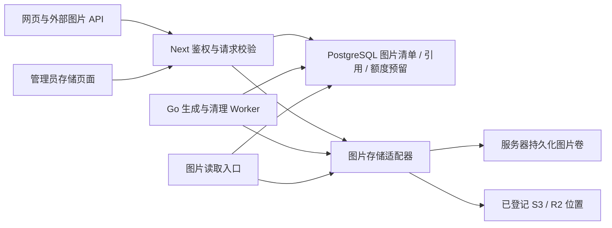

# 图片本地存储与容量清理设计

状态：用户已批准最终规划，按子任务顺序实施；本文件不代表功能已实现。需求以同目录 `prd.md` 为准。视频文件与视频专用封面不进入此次存储、迁移、计量或清理。

## 1. 系统边界

保留 PostgreSQL、Next.js 和 Go Worker。增加受管理图片的逻辑身份、物理副本、引用与额度预留；本地文件放在持久化卷中。S3/R2 继续作为可选后端，读取按每个图片记录的实际位置选择，不能由当前默认写入配置推断历史位置。

所有实际图片写入都经过同一组额度与登记契约：普通网页参考图、外部 API 参考图、Worker 生成结果、Canvas 导入、历史迁移。`ENABLE_LOCAL_IMAGE_FALLBACK` 继续只表示原有开发 data URL 回退，不能把它改解释为生产本地文件模式。

## 2. 管理对象与数据责任

名称为计划中的模块/模型名，可在实现中按项目命名统一；以下责任和约束不能省略。

| 模型 | 责任及不可变信息 |
| --- | --- |
| `ImageAsset` | 图片逻辑身份、不可猜读取 token、原始 owner、用途（生成结果/普通参考图/画布导入）、原始业务身份、当前可读副本、AVAILABLE/DELETING/DELETED 状态及删除原因。媒体被清理后保留身份；用户/任务的级联删除不能抹掉物理清单。 |
| `ImageStorageLocation` | 已确认的 `LOCAL` 或 `S3` 位置。S3 身份含规范化 endpoint/region/bucket；LOCAL 身份来自持久化卷上的随机 ID。数据库不保存 S3 密钥或把服务器绝对路径下发到客户端。 |
| `ImageObject` | 每个物理副本的 location、不可变 key、已核实长度/摘要、写入和删除状态/token/lease/outcome。`(location,key)` 唯一；迁移副本另记一条，不能覆盖源记录。 |
| `ImageReference` | 保存画布、已提交任务输入、在用站点封面及展示/审核用途对逻辑图片的保留关系。生成来源归属本身不是输入保留根。 |
| `ImageQuota` / `ImageWriteReservation` | 全站已计量量、未物化预留和幂等写入身份。总数用 PostgreSQL BIGINT、Go int64；JSON 字节数使用十进制字符串，前端仅在已校验安全范围内转换显示。 |
| `ImageStoragePolicy` | 策略版本、容量上限、容量清理开关、定时开关、保留天数、周期/下一次运行。配置状态区分尚未启用与已启用，旧 S3 部署升级不会立即开始批量删除。 |
| `ImageMaintenanceJob` / item | 手动、定时、额度回收和迁移的持久请求、候选快照、处理游标、领取租约、结果与实际释放量。清理与迁移共用物理对象的排他状态，不各建一套删除器。 |

业务关联使用 nullable live FK 加不可变原始身份，或等价的不会被级联删除的登记方式。`GenerationImage` 可关联 `ImageAsset`；新增普通媒体清单不能沿用 User→Job→Image 的 cascade 生命周期。

5GB 明确定义为 **5,000,000,000 字节**，界面使用 GB。全站额度覆盖已登记的受管理图片物理副本及尚未物化的预留，一个字节归入其中一项，不能双算。数据库、日志、缩略图缓存及文件系统开销另占磁盘，不作为“原图额度已保证”的一部分。未核实归属/大小的旧对象单独显示待盘点，不计入可承诺精确的已纳管用量，也不能被自动删除。

## 3. 本地存储与访问契约

- 后端选择、媒体根目录和卷身份属于 `contracts/runtime/v1/environment.json` 的 shared 配置，两端唯一 loader、公开示例和部署文档同步。保留现有 S3 配置作为历史位置与可选写入目标。
- 卷内 key 由服务生成，不接受客户端磁盘路径。校验 resolved root、路径段与符号链接边界；上传临时文件位于同一受控卷，使用排他创建和不覆盖的最终发布。临时字节由本次预留覆盖，发布不创建第二份未计量副本。
- 核实内容长度与摘要后才公布 READY；无法确定写入结果的对象保留 identity、预留/计量和隔离状态。只允许清理已登记的精确文件；不会递归清空用户提供的目录。
- 对外使用稳定绝对 HTTP(S) 地址，如 `APP_URL/media/images/<opaque-token>`。读取 token 至少 128 位随机熵，不从用户 ID 或文件名推导，不支持目录枚举。
- 保持现有 S3 图片链接的访问兼容语义：持有不可猜链接可以读取图片字节；作品元数据/提示词仍经过原权限判断。本轮不引入会破坏图片优化器、下载代理、provider 拉取的 cookie-only 文件服务。
- 路由只返回已发布当前副本的字节，支持 GET/HEAD、准确 MIME/Content-Length/ETag、`nosniff` 和有界流式读取；删除态返回稳定不可用状态。浏览器、Next 优化、下载代理、外部 API 的 `b64_json` 转换均需验证。
- 对应用自己已登记的图片，内部调用从受信逻辑 ID/精确历史 URL 别名读取，不依赖服务器访问自己的公网域名。任意第三方 URL 仍走现有公网 IP/DNS/重定向检查，不能全局放宽 SSRF 约束。
- 不改变旧任务的冻结 URL/输入快照来迁移图片。精确旧 URL 别名指向经过核实的受管理图片；所有内部读入口先按受信记录解析当前副本。任意前缀匹配不能创建别名或所有权。
- 图生视频当前没有渠道且视频改造不在范围内，但图片 URL 保留 HTTP(S) 兼容性；图片存储不得使现有传递参考图 URL 的调用格式失效。

## 4. 写入、预留与计费边界

1. 验证类型、请求数量、单文件大小。已有 Canvas 8MiB/账户 1GiB 等限制保持；普通图片结果增加统一的最多 50MiB 单图边界，并校验输出张数不超过请求承诺的数量，覆盖上游 URL 和 b64 两种形态。
2. 上传的确定字节数先原子预留。生成结果在 provider side effect 前预留经过边界证明的输出预算；绑定内部提交身份/任务而不是浏览器进程。Node 提交与 Go 内部 enqueue 均覆盖，Worker 在 handoff 前复核，不以“另一个入口肯定做过”作保证。
3. 额度 gate 在短事务内串行更新 `used + unmaterializedReserved`。预留不足先退出事务，由清理执行器回收所需空间，再有界重试；不在全站锁内执行文件 IO、provider 调用或等待批量删除。
4. 预留成功后登记具体 object、执行写入；核实长度/摘要并转为物理计量，实际小于预算的剩余额度归还。按写入身份重放只转换一次，不能重复扣空间。
5. 成功任务的媒体绑定与新引用在现有业务事务中提交。任务/多图部分失败仍保留所有已落盘对象的清单，未发布的对象进入已知失败/待协调状态，不能靠任务回滚把文件当作不存在。
6. 预留过期只是需要协调的信号，不是释放字节的证据；未知 PUT、晚到完成、文件写完但 DB ACK 丢失均要确认后再释放。

锁协议需要在共享存储契约中固定：独立额度预留先于持有 canvas/run/owner/asset 锁的业务事务；对象计量 finalizer 使用一致顺序；新增引用和删除 claim 使用同一资产状态锁。不得给现有 Canvas 的 owner/CAS/asset 加锁链引入反向的全站额度锁。用真实数据库竞争测试证明这一边界。

容量不足在 provider handoff 前尽早返回，不调用上游。若已发生 handoff 后仍出现磁盘/存储故障，沿用 `RESULT_PERSIST_FAILED` 和当前各契约版本的退款/UNKNOWN 语义；**v0/v1 不能合并成一套新的退款政策**。不得因持久化失败自动再次向上游付费生成。

## 5. 引用保护与 Canvas 演进

- 新的可回收生成图片需要覆盖 `Canvas.scene` 中的 result、`CanvasRun.inputSnapshot` 的 result 输入和普通 `sourceImageUrls`；已有两张 Canvas root 表只覆盖 IMPORT，不能拿它们证明生成结果无引用。
- 保存快照、提交任务、设置精选/待审核/撤下待审、设置站点封面时，与清理 claim 协调锁定逻辑图片并重新检查可用性。浏览器尚未保存的草稿不伪造服务端 root；最后一次保存的快照仍受保护。
- 已提交输入关系不会因任务从 PROCESSING 变成终态而自动释放。现有 Canvas 原图长期 job roots，包括任务/账户删除后保留的 root，继续有效。普通生成输出仅有来源 job 不构成永久 root。
- Canvas 无根导入素材仍要脱离至少 604800 秒；手动清理、容量压力和管理员保留天数均不能缩短它。原图每账户计量继续是一张逻辑导入图片的额度，全站计量则覆盖其实际物理副本，二者不能混用。
- 保留现有 `CanvasImportAsset.id`、上传身份和业务 roots；增加显式 provider 与通用图片/副本关联。S3-only 列对新 LOCAL 行采用受判别约束的 nullable 形态，不能填写虚假的 S3 endpoint/bucket。已有 S3 行的原位置/key/字节/摘要继续不可变。
- 迁移只追加物理副本和切换经过验证的活动读取指针；原始 S3 上传事实留在旧记录中。副本删除和整张图片删除是不同状态转换：有合法保留引用的逻辑图片仍可迁移，但不能失去其最后一个验证可读副本。
- 引入明确的存储/GC 能力修订，Node/Go 同步验证 provider、位置、schema 与 executor 版本。LOCAL 不能假报旧 S3 能力探测成功；场景与生成请求的已有业务 wire 不因存储位置改变而重写。
- 仅增加表列不足以排斥旧 Worker：现有探针对额外对象宽容。新增 migration 要更新已知 guard/claim 的版本或指纹，同时在部署中 drain 旧 Worker。旧 GC 的跨 location quarantine 逻辑也须纳入修订。
- 每个物理对象只归一个删除执行器领取。Canvas 到新清单的状态桥接保留旧 unknown PUT/根/七天 guards；旧 scheduler 不得与新清理器同时发出该对象的 Delete。

## 6. 清理规则、调度与管理 API

所有入口共用候选判定与执行器，差别只在选择范围。稳定排序为 `(createdAt,id)`，不是文件名或扫描返回顺序。

| 入口 | 选择范围 |
| --- | --- |
| 一键清理 | 预览当前可清理图片；默认按页面选定的保留天数筛选，也可显式预览所有可清理历史图。确认绑定候选快照，不自动扩大范围。 |
| 定时清理 | 启用后按周期清理超过保留天数的未保护图片。初始建议每 24 小时检查、保留 30 天，管理员可修改；定时开关默认关闭，需在管理页面开启。 |
| 容量清理 | 策略启用后，写入/预算预留不足时从最旧可清理图片开始，直到满足此次需要；可以清理尚未达到定时天数的普通历史图，仍遵守引用/上传保护和 Canvas 七天宽限。 |

保留天数是定时/手动年龄筛选，不是对所有普通历史图的最低保留承诺。受保护对象占满额度时，返回容量不足，不强制删除、不降低保护、不把新结果改存大 base64。

建议的管理边界：

| 接口 | 输入与输出要点 |
| --- | --- |
| `GET /api/admin/storage` | 用量、预留、上限、待盘点量/条数、可清理量、后端/位置摘要、策略版本、最近执行。 |
| `PATCH /api/admin/storage/policy` | 带 expectedVersion 的额度/开关/保留天数/周期修改；返回新版本和下一次运行。降低上限不能直接删文件或虚减统计，需按清理规则收敛。 |
| `POST /api/admin/storage/cleanup/preview` | 有界筛选条件 → previewId、policyVersion、expiresAt、候选数量/字节和跳过原因。 |
| `POST /api/admin/storage/cleanup` | previewId + 幂等 requestId → maintenanceJobId；过期/策略变更要求重新预览。 |
| `GET /api/admin/storage/jobs/:id` | 状态、进度、实际释放量、成功/失败/跳过、恢复信息；不泄露真实路径/密钥。 |

沿用 `requireAdminRecord`、集中 Zod schema、`{data}` / `{error,code}` envelope。所有读写管理端点都鉴权。列表与预览有明确分页/上限；大任务持久化并由 Worker 领取，浏览器关闭或 HTTP 超时不丢工作。

Worker 使用数据库时钟、持久 lease、逐对象 token、有界批次/截止和失败退避。候选执行时再次检查引用；后来新出现的保护关系导致跳过。只有可靠 DELETE/精确 missing 证明才更新释放量，未知写入需要单独协调。历史记录显示“图片已清理”，生成状态、提示词与计费事实保留；下载/复用按钮不可继续消费被清理文件。

## 7. 旧 R2 盘点与迁移

工具以登记清单为单位，不通过扫描整个 bucket 或 URL 前缀自动推断所有权。盘点覆盖生成图片、普通上传参考图、Canvas 导入、当前展示/封面与保存场景/任务输入引用。来源不明的历史 URL 保持可读并标为未纳管，待显式核对。

迁移状态为 `PLANNED → COPYING → VERIFIED → ACTIVE_LOCAL → SOURCE_RETAINED/SOURCE_REMOVED`，错误可恢复。先核实来源位置与对象，再预留目标字节、复制、校验大小/摘要、事务切换活动副本。源副本直到确认删除仍计量；迁移中缺额与普通写入走同一额度规则，不为迁移暗中绕过 5GB。

默认 dry-run，执行要求显式 apply；默认保留源，源删除是独立明确选项并在复制验证/读取别名/在途消费者检查通过后逐对象执行。源与目标同时存在的占用必须展示；需要额外迁移空间时可先回收符合规则的旧图，或由管理员明确调整额度。迁移失败不能删源后再重试生成。

旧 `CanvasImportAsset` 的 immutable 字段不更新；旧任务冻结输入不重写；媒体 ID、job/run/画布关联稳定。应用内部旧 URL 通过精确别名解析新位置。用户此前复制到站外的原 R2 URL 在源删除后不保证继续可用，这不属于应用内部链接兼容承诺，迁移预览和文档应说明。

S3 清理只支持经过验证可可靠回收的已登记位置。版本状态未知/已启用或来源无法确认时，保留对象并报告不可回收，不把一个 DeleteObject 的返回当作已释放所有历史版本。

## 8. 部署、启用与回滚

- embedded：同一应用容器中的 Node/Go 共享持久化图片卷。Worker ready 早于 Next 启动，本地卷探针只验证卷身份/访问能力，不依赖 Next 媒体路由。
- dedicated：app 与参与写入/清理的 Worker 挂载同一宿主机图片卷。卷身份可验证，不允许仅同名路径但不同文件系统的组合宣告 ready。跨主机自动共享不在本轮范围。
- 一次性 additive migration 后以匹配的新 app/Worker 部署；旧 Worker drain 完成前不启用新 GC/LOCAL。元数据升级不启动清理；先完成已知历史盘点/引用桥接，再明确启用策略和切换新写入后端。
- `docker-compose.images.yml` 继承基础 Compose 的卷定义，不复制配置。示例、README、runtime manifest、两端 loader 和探针同时更新。
- 数据级回退是停止新清理并选回已验证可读的副本；不复活被清理文件。代码回滚要经过扩展后的 rollback preflight：存在 LOCAL/新存储修订或未决迁移/写入/删除时拒绝旧 Worker；保留 additive schema。

## 9. 实施边界与证据

1. `11-12-image-storage-foundation`：统一清单/引用/容量预留、本地适配器、读取、Canvas 演进和部署基础。此阶段额度不足可明确拒绝；不先放行到未来清理器。
2. `11-12-image-retention-management`：依赖 1，加入实际清理器、调度、管理员网页、额度回收与历史已清理状态。
3. `11-12-image-history-migration`：依赖 1 和 2，完成历史登记/引用补齐、可恢复迁移工具及最终两种拓扑验收。

每个子任务可以在隔离数据上独立验证，但完整功能交付以三者集成为准。验证覆盖并发最后额度、上传/引用/删除竞争、未知回执、进程重启、迁移复制与源删除、旧任务/画布兼容以及明确的视频排除。真实测试仅使用 disposable PostgreSQL、临时目录和模拟 S3；本轮规划与代码交付不等于生产数据迁移或实际 R2 用量验收。
